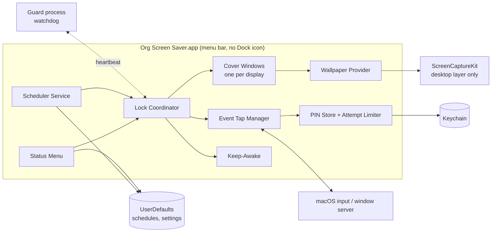
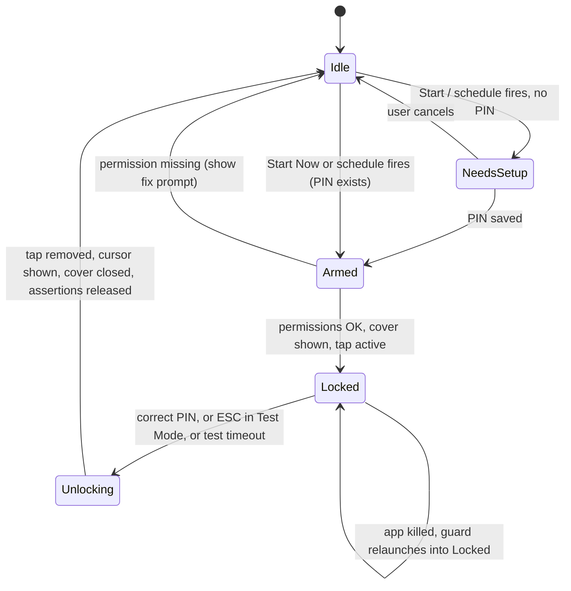
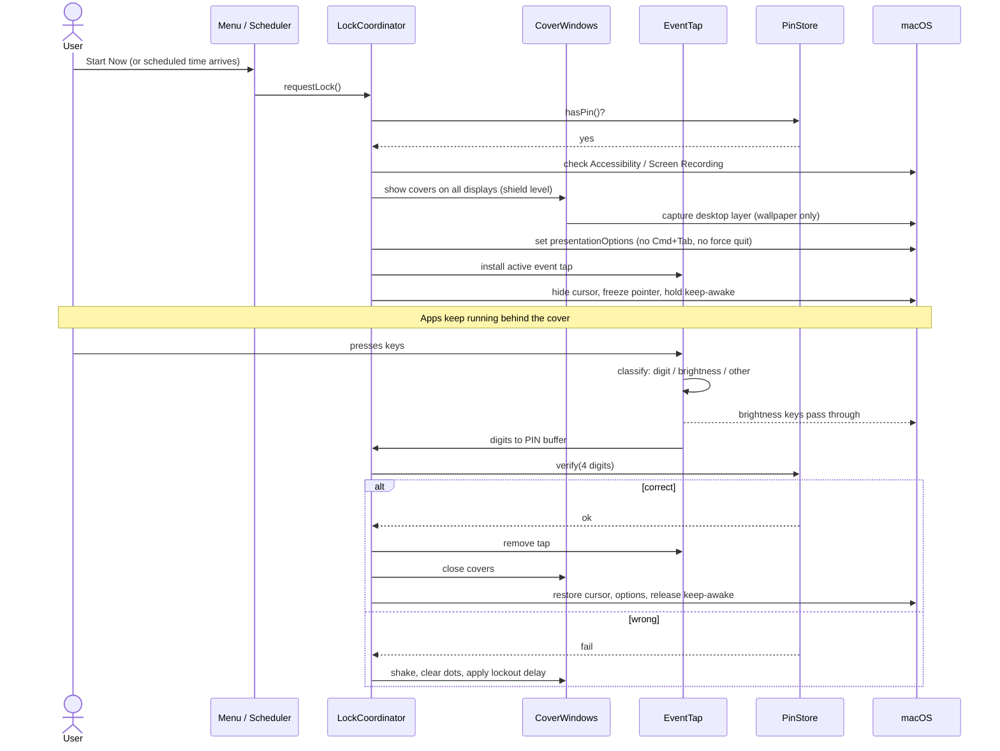
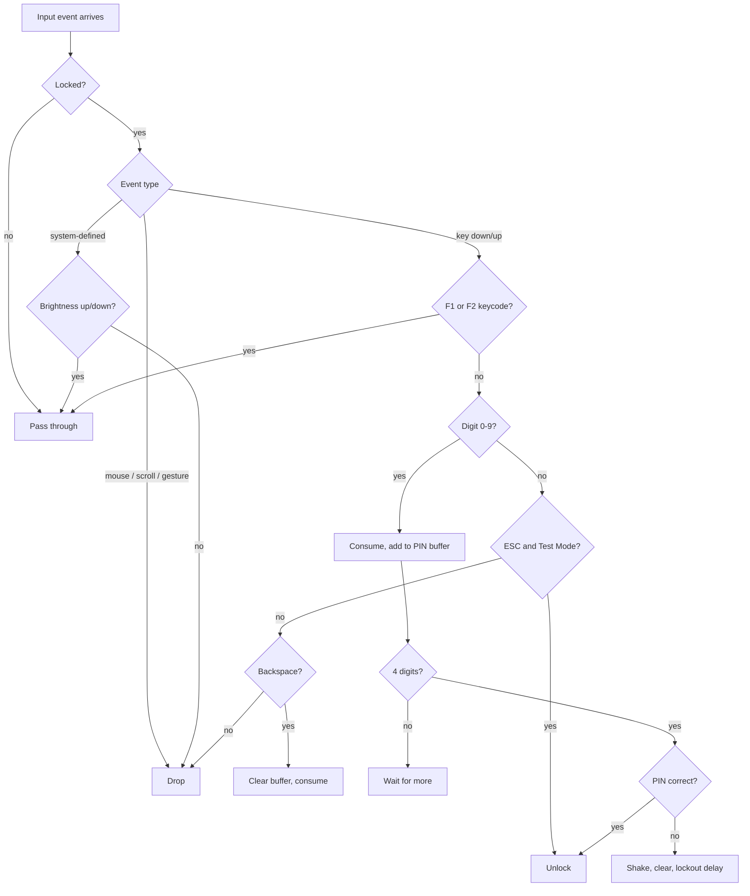
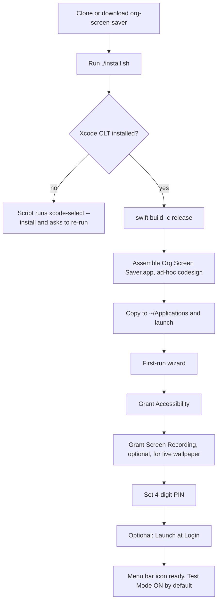

> **Note (1.3.0):** the live wallpaper capture described below (ScreenCaptureKit, Screen Recording) was removed. The cover now shows a still wallpaper or a custom image or video.

# Org Screen Saver: Implementation Plan

Status: **v0.1.0 built (compiles, 20 unit tests pass, app launches). Lock behavior still needs verification on a real session: see TEST-CHECKLIST.md.**

## Revisions after review (these supersede the sections below where they differ)

| # | Decision |
|---|---|
| 1 | **Touch ID by default**, PIN optional in Settings. At least one of the two must stay enabled; the cover refuses to start otherwise. Touch ID is prompted on lock and after any key press. |
| 2 | 4-digit PIN kept. |
| 3 | **Webcam snapshot on every key that is not F1, F2 or a digit** (throttled to 1 per 5 s, 100 per session, 30-day retention, owner-only files). |
| 4 | Optional cover message, empty by default. |
| 5 | **No status changes of any kind**, and Do Not Disturb automation was dropped from scope. |
| 6 | Bluetooth proximity auto-lock is an experimental tab; the user picks which paired devices to watch. |
| 7 | Global shortcut is optional and off by default. |
| 8 | Recovery code is optional at first run. Because only digits are accepted on the cover, it is 8 digits. |
| 9 | Updates via GitHub Releases (checksum-verified in-app updater, release workflow). |
| 10 | Detailed rotating log of lock/unlock, settings changes and more. Secrets are never logged. |
| 11 | **Test mode is a hidden config-file setting**, off by default, not in the UI. File: `~/Library/Application Support/OrgScreenSaver/config.json`. |
| 12 | Screen Recording stays on for live wallpaper; can be removed later if it causes trouble. **Update (1.3.0): removed.** Wallpaper apps pause when covered, so the capture froze; replaced by still wallpaper plus a custom image or video. |
| 13 | Managed Mac: build and observe what MDM does. |

Changes from the original plan: the separate guard process is the same binary started with `--guard`; the Focus/DND idea is removed; proximity and the hotkey were added; Sparkle was replaced by a small GitHub-based updater.

Original plan follows.

---


## 1. Goal

A macOS menu bar app that "soft-locks" the laptop: a full-screen cover hides the screen, swallows all input except a 4-digit PIN and the brightness keys, and cannot be quit or force-quit. Every other app and process keeps running. This is not the macOS lock screen, so nothing is suspended (Omni-Channel presence, calls, builds, downloads stay alive).

## 2. Technology choices

| Decision | Choice | Why |
|---|---|---|
| Language / UI | Swift 5.9+, AppKit (menu bar via `NSStatusItem`), SwiftUI for the settings/PIN-setup windows | Native, small, only way to reach the needed system APIs reliably |
| Build system | Swift Package Manager + a `Makefile`, no Xcode project | Builds from the terminal with just Xcode Command Line Tools, easy to share and review |
| Min macOS | 13 (Ventura) | `SMAppService` for launch-at-login, ScreenCaptureKit |
| Distribution | `install.sh` (build from source, installs to `~/Applications`) plus optional pre-built `.zip` | Building locally avoids Gatekeeper quarantine and Apple Developer signing for a shared internal tool |
| Storage | PIN hash in Keychain; settings and schedules in `UserDefaults` | PIN never stored in plain text |

## 3. Features and how each requirement is met

### R1. Menu bar app
`LSUIElement = true` (no Dock icon, no app switcher entry). `NSStatusItem` with a lock icon.

### R2. Menu: schedule or turn on now
Menu items:
- **Start Screen Saver Now**
- **Schedule...** (one-time at HH:MM, or recurring on chosen weekdays, or "in N minutes")
- **Next scheduled:** (read-only line, with Cancel)
- **Set / Change PIN...**
- **Test Mode** (checkbox, on by default until you turn it off)
- **Launch at Login** (checkbox)
- **Permissions Status...**
- **Quit** (disabled while locked)

Start Now is blocked until a PIN exists (it opens PIN setup first). Schedules are stored in `UserDefaults` and re-armed on launch and after wake from sleep (a missed schedule fires immediately if still inside its window).

### R3. Full-screen cover that keeps the wallpaper (including Backdrop)
One borderless `NSWindow` per connected display, at `CGShieldingWindowLevel()`, joined to all Spaces, covering menu bar and Dock.

Wallpaper handling, in order of preference (chosen at runtime, user can override in settings):
1. **Live wallpaper capture (best, supports Backdrop).** Backdrop draws its video/animated wallpaper in its own windows at desktop level, so `NSWorkspace.desktopImageURL` cannot see it. Use **ScreenCaptureKit** with a content filter that includes *only* desktop-level windows (wallpaper owner windows, layer below desktop icons) and excludes every app window. Stream those frames into a layer in the cover window. The result is the live wallpaper with nothing sensitive visible. Needs **Screen Recording** permission.
2. **Static wallpaper.** `NSWorkspace.desktopImageURL(for:)` per screen. Works for normal wallpapers, no extra permission.
3. **Dark fallback.** Solid black with a soft clock.

On top of the wallpaper: a subtle dim layer, an optional clock, and PIN dots when typing. Nothing else.

Important design note: the window must never be transparent to the apps behind it. Showing the real desktop by making the window see-through would expose open windows. Capturing only the wallpaper layer is what makes this safe.

### R4. Hidden cursor, input swallowed, PIN and F1/F2 allowed
- **Cursor:** `CGDisplayHideCursor` on all displays, plus `CGAssociateMouseAndMouseCursorPosition(false)` so the pointer is frozen. Cursor is restored on unlock and on any crash/exit path.
- **Input interception:** a session-level **active `CGEventTap`** (needs Accessibility permission) installed at lock time. Every event goes through the decision flow in diagram 4:
  - Mouse move, click, scroll, gestures: dropped.
  - Digits 0-9 (main row and keypad): consumed and fed to the PIN buffer. Not forwarded to any app.
  - Brightness keys: passed through untouched (see below).
  - Everything else (letters, Cmd/Opt/Ctrl combos, Mission Control, Spotlight, media keys, volume): dropped.
- **Brightness F1/F2:** on Apple keyboards these arrive as `NX_SYSDEFINED` events (subtype 8, keys `NX_KEYTYPE_BRIGHTNESS_DOWN` = 3 / `UP` = 2), and as plain F1/F2 keycodes (122 / 120) when the "use F keys as standard function keys" setting is on. Both forms are allowed through, so macOS handles brightness itself and we do not reimplement it. The brightness HUD may be hidden by the cover; we draw our own small brightness indicator if so.
- **PIN entry:** typing digits fills 4 dots. On the 4th digit the entry is verified (constant-time compare of PBKDF2-SHA256 hash with per-install salt). Wrong PIN: shake animation, buffer cleared, escalating delay (3 wrong = 30 s lockout, 6 wrong = 5 min). Buffer auto-clears after 5 s idle. Backspace clears the buffer.
- **Fallback input path:** the cover window is key and also has a local `NSEvent` monitor, so if the event tap is ever disabled by the system or starved by another app's Secure Event Input, PIN entry still works. A watchdog re-enables the tap if macOS disables it (`tapDisabledByTimeout`).

### R5. Cannot be minimized or exited, including force quit
Layered, because no single mechanism is enough:
1. **`NSApplication.presentationOptions`**: `.hideDock`, `.hideMenuBar`, `.disableProcessSwitching` (blocks Cmd+Tab), `.disableForceQuit` (blocks Cmd+Opt+Esc), `.disableSessionTermination` (blocks logout/shutdown dialogs), `.disableHideApplication` (blocks Cmd+H), `.disableAppleMenu`. These are the same options kiosk apps use.
2. **Window level + collection behavior:** shielding level, `.canJoinAllSpaces`, `.fullScreenAuxiliary`, `.stationary`, no title bar or buttons, `canHide = false`.
3. **Event tap** swallows remaining shortcuts (Cmd+Q, Cmd+W, Cmd+M, Ctrl+Cmd+Q lock, Mission Control keys, Cmd+Space).
4. **Self-healing:** a tiny separate helper process (`orgscreensaver-guard`, launched by the main app) watches the main app; if it dies while locked, the guard relaunches it directly into locked state. The main app does the same for the guard. This covers crashes and `kill`.
5. **Single instance + `SIGTERM`/`SIGINT` handlers** ignored while locked.

Honest limits (will be in the README): holding the power button, a hard reboot, or an SSH/remote `kill -9` from another machine can still defeat it. This is a privacy cover for stepping away, not a security boundary against a determined attacker with physical access. Use the macOS lock screen for that.

### R6. Test mode with ESC
A **Test Mode** flag (default ON for early versions, shown clearly in the menu). While on, ESC unlocks immediately and the cover shows a small "TEST MODE: ESC to exit" label. Extra fail-safe while testing: an automatic unlock after N minutes (default 5, configurable). Test Mode can only be switched off from the unlocked menu, and turning it off asks for the PIN.

Release builds can be compiled with `make release` where test mode defaults off, and the ESC and timeout paths remain only behind the user-visible toggle.

### R7. Everything else keeps running
- The app does not lock the session, so processes, network, Slack/Omni-Channel, calls and screen shares continue.
- **Keep-awake:** while locked, hold `IOPMAssertionCreateWithName` for `PreventUserIdleSystemSleep` (and optionally `PreventUserIdleDisplaySleep`, default on, so the cover stays visible and presence stays "active"). Released on unlock.
- **Notifications:** banners appear above normal windows and could leak content. On lock, optionally turn on a Focus/Do Not Disturb (user-togglable, default on). Needs a Shortcut the user installs or a one-time permission; falls back to a README warning if unavailable.
- Audio output and incoming calls continue; the cover has no effect on them.

## 4. Architecture

```
org-screen-saver/
  README.md
  Makefile
  install.sh
  uninstall.sh
  Package.swift
  docs/PLAN.md
  Sources/OrgScreenSaver/
    App/            AppDelegate, StatusMenuController, LaunchAtLogin
    Lock/           LockCoordinator (state machine), CoverWindowController,
                    WallpaperProvider (SCK / static / black), CursorHider
    Input/          EventTapManager, KeyClassifier, PinEntryModel
    Security/       PinStore (Keychain + PBKDF2), AttemptLimiter
    Schedule/       ScheduleStore, SchedulerService (timers, wake handling)
    Power/          KeepAwake (IOPMAssertion)
    Settings/       SettingsView, PinSetupView, PermissionsView
    Guard/          GuardProcess (watchdog helper, same binary, `--guard` flag)
  Tests/OrgScreenSaverTests/  KeyClassifier, PinStore, AttemptLimiter, Scheduler
  assets/           AppIcon.png (1024px master), AppIcon.icns (copied into the bundle)
  scripts/          build-app-bundle.sh (assemble .app, copy icon, codesign)
```

Key units are small and testable without UI: `KeyClassifier` (event in, decision out), `PinEntryModel`, `AttemptLimiter`, `SchedulerService`.

## 5. Diagrams

### Diagram 1: Components



### Diagram 2: Lock state machine



### Diagram 3: Lock and unlock sequence



### Diagram 4: Key handling decision flow



### Diagram 5: Install flow for a teammate



## 6. Permissions required

| Permission | Needed for | If denied |
|---|---|---|
| Accessibility | Active event tap (swallow keys, force-quit shortcuts) | Cannot lock: app refuses to start the cover rather than lock without input blocking |
| Screen Recording | Live wallpaper capture (Backdrop) | Falls back to static wallpaper, then black |
| Login Item (optional) | Auto-start so schedules fire | Schedules only work while the app is running |

The first-run wizard checks each, deep-links to the right System Settings pane, and re-checks automatically.

## 7. Milestones

1. **M1 Skeleton:** menu bar app, Settings window, PIN setup/store, install script that produces a runnable `.app`.
2. **M2 Cover:** multi-display cover windows, presentation options, cursor hide, Test Mode ESC + timeout. Verify force-quit/Cmd+Tab blocking.
3. **M3 Input:** event tap, key classifier, PIN entry, brightness pass-through, lockout limiter, watchdog for tap.
4. **M4 Wallpaper:** static wallpaper, then ScreenCaptureKit desktop-layer capture, verified against Backdrop.
5. **M5 Schedule:** one-time and recurring schedules, wake-from-sleep handling.
6. **M6 Hardening:** guard process, keep-awake, DND, multi-display and sleep/wake edge cases, unit tests.
7. **M7 Packaging and docs:** `install.sh`, `uninstall.sh`, release zip, README finalized.

Each milestone is runnable and testable on its own, always with ESC enabled until M6 sign-off.

## 8. Testing strategy

- Unit tests: key classification, PIN hashing/verify, lockout timing, schedule next-fire calculation.
- Manual checklist (kept in `docs/TEST-CHECKLIST.md`): Cmd+Tab, Cmd+Opt+Esc, Ctrl+Cmd+Q, Mission Control, Spotlight, F1/F2, media keys, mouse clicks, 2nd display, unplug/plug display while locked, sleep/wake, Backdrop running, Slack/Omni-Channel stays online, kill from Activity Monitor (blocked) and from terminal (guard relaunches).
- Safety rails during development: Test Mode on, 5-minute auto-unlock, and a documented recovery path (SSH or second Mac: `pkill -f OrgScreenSaver`).

## 9. Risks and open questions

| Risk | Mitigation |
|---|---|
| `disableForceQuit` behavior can vary across macOS versions | Verify on your macOS version in M2; event tap is a second layer |
| ScreenCaptureKit may not return Backdrop's windows | Spike in M4 first; static and black fallbacks exist |
| macOS shows a recurring "app is recording your screen" prompt (Sequoia and later) | Warm up with a real capture every 20 min while unlocked (never during a lock); live wallpaper is optional |
| Notification banners can appear over the cover | DND on lock, documented |
| Accessibility permission resets after rebuilds with a new signature | Use a stable ad-hoc identity in `build-app-bundle.sh`; wizard re-checks |
| Corporate MDM may restrict Accessibility or unsigned apps | Local build avoids quarantine; confirm with IT if MDM blocks it |
| Touch Bar / external keyboards send brightness differently | Handle both sysdefined and F-key forms, test with external keyboard |

Open questions for you: see the end of the chat summary.

## 10. Suggested improvements (beyond the current scope)

**Security**
1. **Touch ID unlock** as an alternative to the PIN (`LocalAuthentication`).
2. **Longer or alphanumeric passcode option.** A 4-digit PIN has only 10,000 combinations; the lockout limiter helps, but a longer code is much stronger.
3. **Intruder photo.** After 3 wrong PINs, take a webcam snapshot and save it locally with a timestamp.
4. **Notify on failed attempts**, e.g. a local notification or a Slack DM to yourself.
5. **Lock on lid/idle triggers.** Auto-start when you leave: Bluetooth proximity of your phone or Apple Watch, or after N minutes idle.

**Experience**
6. **Status for coworkers:** a configurable message on the cover ("Back in 10 min", "In a meeting"), possibly with a countdown.
7. **Auto-set Slack/Omni-Channel status** on lock and restore on unlock, if you want presence to say "away" or "busy" instead of silently active.
8. **Quick global hotkey** to start the screen saver (registered only while unlocked).
9. **Duration timer:** "lock for 15 minutes" that reminds you rather than unlocking on its own.
10. **Visual themes:** clock styles, subtle motion to prevent burn-in, per-display options.
11. **Show-through widgets:** optionally show harmless info on the cover (time, next meeting title hidden by default, battery).

**Operations and sharing**
12. **Homebrew tap** (`brew install --cask org-screen-saver`) once you have a signed and notarized build, plus Sparkle auto-updates.
13. **Developer ID signing and notarization** to remove all Gatekeeper friction for teammates.
14. **Log file** (`~/Library/Logs/OrgScreenSaver`) of lock/unlock events for troubleshooting.
15. **MDM-friendly config profile** so IT can pre-approve permissions and set defaults.
16. **Emergency exit code:** a separate, longer recovery passphrase stored in Keychain for when the PIN is forgotten.
